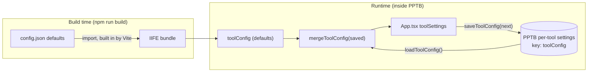

<!-- cspell:ignore locaton -->

# Tool configuration (`src/config/`)

This folder defines the tool's own configuration: the Settings-panel values and the list of saved projects.
It's separate from `.dataverse-gen.json`, the per-project file shared with the dataverse-gen CLI, which lives
in `src/core/config.ts`.

| File | Role | Bundled? |
| --- | --- | --- |
| [`dataverse-early-bound-typescript-generator-config.json`](./dataverse-early-bound-typescript-generator-config.json) | Default values, imported by `index.ts` | Yes, built into the bundle |
| [`dataverse-early-bound-typescript-generator-config.sample.json`](./dataverse-early-bound-typescript-generator-config.sample.json) | A fully populated example of every field | No |
| [`dataverse-early-bound-typescript-generator-config.schema.json`](./dataverse-early-bound-typescript-generator-config.schema.json) | JSON Schema (draft-07) for the two files above | No |
| [`index.ts`](./index.ts) | Types, defaults, normalization, comparison, and project versioning | Yes |

The module is framework-free: `index.ts` imports nothing but the default JSON, uses no React or browser
APIs, and never touches PPTB. Reading and writing the stored values is done by `src/services/settings.ts`.

## Contents

- [Storage model](#storage-model)
- [Default config file](#default-config-file)
- [Sample file](#sample-file)
- [JSON Schema](#json-schema)
- [`index.ts` reference](#indexts-reference)
- [Lifecycle](#lifecycle)
- [Project versioning](#project-versioning)
- [Compatibility and changing the shape](#compatibility-and-changing-the-shape)
- [Tests](#tests)
- [Known limitations](#known-limitations)

## Storage model

Configuration comes from two layers, combined at runtime:

1. **Defaults:** `dataverse-early-bound-typescript-generator-config.json`, imported by `index.ts`. Vite
   builds the JSON into the single IIFE bundle, so the defaults are fixed when the tool is built. Editing the
   file has no effect until the next `npm run build`.
2. **Saved values:** stored by PPTB through `window.toolboxAPI.settings` under the key `toolConfig`, in the same
   shape as `ToolConfig`. They're written by the Settings panel, the New Project and Load Existing Project
   dialogs, and after each Generate run.



The tool never writes to the JSON files. It can't: PPTB doesn't expose the tool's install folder (`ToolContext`
has no path), and its file API only allows writes to folders the user picked in the current session. Even if it
could, the bundled copy wouldn't change until the next build.

PPTB's per-tool settings also hold two keys used elsewhere, `projectFolders` and `lastProjectFolder`, which
remember the last project folder per connection. They aren't part of `ToolConfig`.

## Default config file

```json
{
    "$schema": "./dataverse-early-bound-typescript-generator-config.schema.json",
    "deleteOrphanedFiles": false,
    "projectDefaults": {
        "outputRoot": "./src/dataverse-gen",
        "generateEntityTypes": true,
        "generateFormContext": false,
        "generateIndex": true
    },
    "projects": []
}
```

- **`$schema`** links the file to the schema for editor validation. `index.ts` never reads it, and it isn't
  carried into `toolConfig`.
- **`deleteOrphanedFiles`:** `false`. Shown as a checkbox on the Settings panel's Schema Generation tab and
  as the **Delete orphaned files** switch in Preview and generate; both save the same setting. When on,
  Generate deletes orphaned files after the user confirms the list.
- **`projectDefaults`:** the options every project starts with, edited on the Settings panel's Options tab.
  Whenever a project is opened, `applyProjectDefaults` writes these into its config, also over the values in an
  existing `.dataverse-gen.json`; `App.tsx` also applies them to the open project when they change (after the
  saved settings load, or when different ones are saved). The Options card can still change them for the
  project, and Generate saves the result to `.dataverse-gen.json`. The bundled values equal dataverse-gen's
  `.dataverse-gen.template.json`; a missing or mistyped key falls back to them (`BUILT_IN_PROJECT_DEFAULTS`).
- **`projects`:** `[]`. Projects listed here would be offered on every install, before anything is saved.
  They go through the same normalization as saved projects.

`tsconfig.json` sets `resolveJsonModule`, so the import is type-checked. TypeScript infers `projects` as
`never[]` from the empty literal, which is why `index.ts` casts it to `unknown[]` before normalizing.

## Sample file

The sample shows every field with realistic values and isn't imported anywhere. It has two projects:

- **Contoso Sales Web Resources** has been generated: version `1.0.2`, `modifiedOn` later than `createdOn`,
  and a `lastGeneratedFiles` list covering each output folder (`entities/`, `enums/`, `actions/`, `functions/`,
  `complextypes/`) plus `index.ts` and `metadata.ts`.
- **Fabrikam Field Service PCF** was never generated: version `1.0.0`, equal timestamps, an empty description,
  and no `lastGeneratedFiles`.

Passed through `mergeToolConfig` (with `$schema` removed), the sample comes back unchanged: no field is dropped
or defaulted.

## JSON Schema

`dataverse-early-bound-typescript-generator-config.schema.json` uses draft-07, which VS Code supports fully.
Both JSON files reference it through `"$schema"`, so editors validate and autocomplete them without any
workspace settings.

### Structure

```text
root (object, additionalProperties: false)
├── $schema              string
├── deleteOrphanedFiles  boolean, default false
├── projectDefaults      #/definitions/projectDefaults
└── projects             array of #/definitions/project, default []

#/definitions/projectDefaults (object, additionalProperties: false, all optional)
├── outputRoot           string, minLength 1, default "./src/dataverse-gen"
├── generateEntityTypes  boolean, default true
├── generateFormContext  boolean, default false
└── generateIndex        boolean, default true

#/definitions/project (object, additionalProperties: false)
├── id                   string, UUID pattern            required
├── name                 string, minLength 1             required
├── description          string, default ""
├── location             string, minLength 1             required
├── version              string, ^\d+\.\d+\.\d+$, default "1.0.0"
├── createdOn            #/definitions/isoDateTime       required
├── modifiedOn           #/definitions/isoDateTime
└── lastGeneratedFiles   array of non-empty strings, uniqueItems

#/definitions/isoDateTime: string, format date-time
```

`additionalProperties: false` at both levels makes typos such as `locaton` or `deleteOrphanFiles` errors
instead of keys the tool silently ignores.

### Schema versus loader

The schema describes what the tool **writes**. The loader (`normalizeProject` and `mergeToolConfig`) is
deliberately more tolerant about what it **reads**, so a stored value that fails the schema may still load:

| Rule | Schema | Loader |
| --- | --- | --- |
| Required project fields | `id`, `name`, `location`, `createdOn` | Same; a project missing one is skipped |
| `id` format | UUID pattern | Any string |
| `name` | Non-empty | Any string, including empty |
| `name` uniqueness | Not expressible | Not checked; only the New Project dialog prevents duplicates (trimmed, case-insensitive) |
| `version` format | `major.minor.patch` digits | Any non-empty string; empty or missing becomes `1.0.0` |
| `createdOn` / `modifiedOn` | `date-time` format | Any string; empty or missing `modifiedOn` becomes `createdOn` |
| `description` | Optional string | Non-string or missing becomes `""` |
| `lastGeneratedFiles` | Unique non-empty strings | Non-string items dropped; duplicates kept |
| Unknown keys | Rejected | Ignored, and not written back |
| Wrong top-level types | Rejected | The default is used for that key |
| `projectDefaults` values | Typed; `outputRoot` non-empty | Per key: wrong type or blank `outputRoot` (after trimming) uses the default |

Values the loader tolerates are handled where they're used:

- **Dates that can't be parsed** show as the raw string in the Load Existing Project table and sort as the earliest
  date.
- **A non-semver version** sorts as text, and the next patch bump resets it to `1.0.1`.
- **Duplicate entries in `lastGeneratedFiles`** are removed the next time `recordGeneration` writes the list.

### Validating

Nothing in the repo runs the schema automatically. To validate by hand, with `ajv` 8 and `ajv-formats`:

```js
const Ajv = require('ajv');
const addFormats = require('ajv-formats');
const ajv = new Ajv({ allErrors: true, strict: true });
addFormats(ajv);
const validate = ajv.compile(require('./dataverse-early-bound-typescript-generator-config.schema.json'));
validate(require('./dataverse-early-bound-typescript-generator-config.sample.json')); // true
```

Both files pass in strict mode. Missing `id`, version `v1`, date `yesterday`, an unknown key, and a string
`deleteOrphanedFiles` are each rejected.

## `index.ts` reference

### Types

```ts
interface ProjectEntry {
    id: string;                     // crypto.randomUUID()
    name: string;
    description: string;
    location: string;               // absolute folder path
    version: string;                // starts at DEFAULT_PROJECT_VERSION
    createdOn: string;              // ISO 8601
    modifiedOn: string;             // ISO 8601; equals createdOn until changed
    lastGeneratedFiles?: string[];  // absent until first generated
}

interface ProjectDefaults {
    outputRoot: string;             // trimmed, never blank
    generateEntityTypes: boolean;
    generateFormContext: boolean;
    generateIndex: boolean;
}

interface ToolConfig {
    deleteOrphanedFiles: boolean;
    projectDefaults: ProjectDefaults;
    projects: ProjectEntry[];
}

interface GenerationResult {
    files: string[];     // every file the run generated, written or already up to date
    newFiles: string[];  // files the run created on disk
}
```

`lastGeneratedFiles` is optional rather than empty-by-default on purpose: `undefined` means "never generated",
which `recordGeneration` treats differently from "generated, but produced nothing".

### Constants

| Export | Value | Use |
| --- | --- | --- |
| `DEFAULT_PROJECT_VERSION` | `'1.0.0'` | New projects, and projects saved without a version |
| `toolConfig` | `ToolConfig` built from the default JSON | Initial `toolSettings` in `App.tsx`, and the fallback in `loadToolConfig` |

### `mergeToolConfig(saved: unknown): ToolConfig`

Builds a complete `ToolConfig` from stored data, falling back to `toolConfig` key by key:

- `saved` that isn't an object (including `undefined`, which PPTB returns for a missing key) is treated as
  `{}`, so the result equals the defaults.
- `deleteOrphanedFiles` is taken only if it's a boolean.
- `projectDefaults` is merged key by key over `toolConfig.projectDefaults`: booleans only if boolean,
  `outputRoot` only if a non-blank string (stored trimmed).
- `projects` is taken only if it's an array, then normalized. The result is a new array; a stored array is never
  merged with the default projects.
- Every other key is dropped.

The returned object always has its keys in the same order. That matters for `toolConfigEquals`.

### `normalizeProject` / `normalizeProjects` (internal)

`normalizeProject` returns `undefined` unless the value is an object whose `id`, `name`, `location` and
`createdOn` are strings. Otherwise it builds a new `ProjectEntry` in a fixed key order:

| Field | Taken when | Otherwise |
| --- | --- | --- |
| `description` | String | `''` |
| `version` | Non-empty string | `DEFAULT_PROJECT_VERSION` |
| `modifiedOn` | Non-empty string | `createdOn` |
| `lastGeneratedFiles` | Array (non-strings removed) | Key omitted |

`normalizeProjects` maps and filters out the `undefined` results, keeping the original order.

### `applyProjectDefaults(config, projectDefaults): DataverseGenConfig`

Returns `config` with `generateEntityTypes`, `generateFormContext`, `generateIndex` and `output.outputRoot`
taken from `projectDefaults`. Everything else is kept: the selection, other `output` keys such as
`fileSuffix`, and `referencedTypes`. `App.tsx` calls it in `openProjectFolder` only when the folder has no
`.dataverse-gen.json` (`state.exists === false`).

### `toolConfigEquals(a, b): boolean`

Compares `JSON.stringify(a) === JSON.stringify(b)`. It's used by the Settings panel to enable **Save** only when
the draft differs from the saved values.

Because the comparison is textual, it depends on key order. That holds as long as both sides come from
`mergeToolConfig`, `normalizeProject`, or a spread of such an object, which all keep keys in declaration order.
Don't build a `ToolConfig` literal with keys in a different order and compare it.

### `bumpPatchVersion(version): string`

`'1.2.3'` → `'1.2.4'`; surrounding whitespace is ignored. Anything that isn't exactly three dot-separated
digit groups (`'v1'`, `'1.0'`, `'1.0.0-beta'`) returns `'1.0.1'`.

### `recordGeneration(project, result, now): ProjectEntry | undefined`

Pure function that decides how a Generate run affects a saved project. See
[Project versioning](#project-versioning). It never mutates `project`. It returns a new object when something
changed, or `undefined` when the stored project is already correct, so the caller can skip the write.

## Lifecycle

All writes go through `saveToolConfig(next)`, which replaces the whole stored `toolConfig` value. On success,
`App.tsx` replaces its `toolSettings` state with `next`.

| Event | Where | Change |
| --- | --- | --- |
| Tool loads | `App.tsx` effect → `loadToolConfig()` | `toolSettings` starts as `toolConfig`, then becomes `mergeToolConfig(stored)` |
| Settings → Save | `SettingsPanel` → `saveToolSettings` | The whole draft, normalized with `mergeToolConfig` (so a blank output folder saves as the default), including the `projects` it was opened with |
| Open a folder without `.dataverse-gen.json` | `openProjectFolder` | Nothing saved; the new project's config gets `projectDefaults` |
| New Project → Save | `NewProjectDialog` → `addProject` | Appends `{ id, version: '1.0.0', createdOn, modifiedOn }` plus the form values |
| Load Existing Project → Delete | `LoadProjectDialog` → `deleteProject` | Removes the project by `id` |
| Generate | `runGenerate` → `recordProjectGeneration` | The project whose `location` matches the open folder, if `recordGeneration` returns a change |

Error handling differs by operation:

- **`loadToolConfig`** never throws. Outside PPTB it returns a copy of the defaults. If PPTB's `get` fails, it
  logs a warning and returns the defaults.
- **`saveToolConfig`** throws outside PPTB, and passes through PPTB's errors. The Settings panel and both dialogs
  show the error and stay open.
- **After Generate**, a failed save is only logged (`console.warn`), because the generated files have already
  been written.

The open folder is matched to a project with `isSamePath` (`src/services/paths.ts`). It ignores `\` versus `/`
and trailing separators. For Windows paths (drive letter or UNC) it also ignores case.

## Project versioning

After a successful write, `App.tsx` calls `recordGeneration` with:

- `files`: every planned file except orphans, by `relativePath` (the on-disk name when casing was reused)
- `newFiles`: files whose status was `new`

| Previous `lastGeneratedFiles` | Condition | Result |
| --- | --- | --- |
| Absent (first run) | `newFiles` not empty | Patch bump, `modifiedOn = now`, list recorded |
| Absent (first run) | `newFiles` empty | List recorded only |
| Present | Any file added or removed (set comparison) | Patch bump, `modifiedOn = now`, list recorded |
| Present | Same set, any order | `undefined` (nothing to save) |

The comparison is against the previous run's list, not the disk. Orphaned files are deleted only when
Delete orphaned files is on and confirmed, so they usually stay on disk and a disk-based comparison would
count them as dropped on every run and bump the version each time. Content
changes to the same set of files never bump the version. The recorded list is de-duplicated and sorted, so
storage stays stable across runs.

## Compatibility and changing the shape

Saved data outlives tool versions, so every change has to load data written by older builds:

- **Adding an optional project field:** give it a default in `normalizeProject`, as `version` and `modifiedOn`
  were added.
- **Never make a new field required in `normalizeProject`.** Projects saved before it existed would be
  silently dropped.
- **Removing a field:** stop reading it. `mergeToolConfig` drops unknown keys, so it disappears from storage on
  the next save.

To add a new setting:

1. Add it to `ToolConfig` in `index.ts`, with a TSDoc comment.
2. Add its default to `dataverse-early-bound-typescript-generator-config.json`.
3. Read it in `toolConfig`, and in `mergeToolConfig` with a type check and a fallback to `toolConfig`.
4. Add it to the schema, with `type`, `default` and `description`, and to the sample.
5. Add the control to `SettingsPanel` and update the draft through `update({ … })`. `toolConfigEquals` picks
   it up automatically.
6. Extend `test/settings.test.ts`: defaults, merge with valid and invalid values, and the panel's Save state.
7. Run `npm test` and `npm run build`, then validate the JSON files against the schema.

## Tests

| File | Covers |
| --- | --- |
| `test/settings.test.ts` | Defaults from the JSON; `mergeToolConfig` with unknown, mistyped and partial values, including the defaults for old projects; `toolConfigEquals`; `loadToolConfig` / `saveToolConfig` against a stubbed `toolboxAPI.settings` and outside PPTB; Settings panel Save/Cancel; New Project and Load Existing Project dialogs |
| `test/projectVersion.test.ts` | `bumpPatchVersion`; every `recordGeneration` branch; `lastGeneratedFiles` round-trip; `isSamePath` |

## Known limitations

- **`deleteOrphanedFiles` deletes through a terminal.** PPTB's file API has no delete, so deletion runs
  `Remove-Item` or `rm -f` in a hidden PPTB terminal and is verified afterwards with `fileSystem.exists`. Files
  that remain are reported as an error. Deletion is permanent (no Recycle Bin or Trash).
- **Last write wins.** `addProject`, `deleteProject` and `recordProjectGeneration` each build `next` from the
  `toolSettings` value they captured, then save the whole config. If two writes overlap, the later one replaces
  the earlier one's change. The UI makes this unlikely (dialogs are modal, and generation runs while the tool
  is busy), but nothing prevents it.
- **Before saved values load.** For a moment after startup, `toolSettings` holds the defaults. A project
  created in that window is checked for duplicate names against the default list only, and saved on top of it.
- **Saved data isn't validated against the schema.** Only the loader's checks apply when reading from PPTB's
  storage.
- **Defaults are fixed at build time.** Changing `dataverse-early-bound-typescript-generator-config.json`
  needs a rebuild, and values a user saved still override it.
